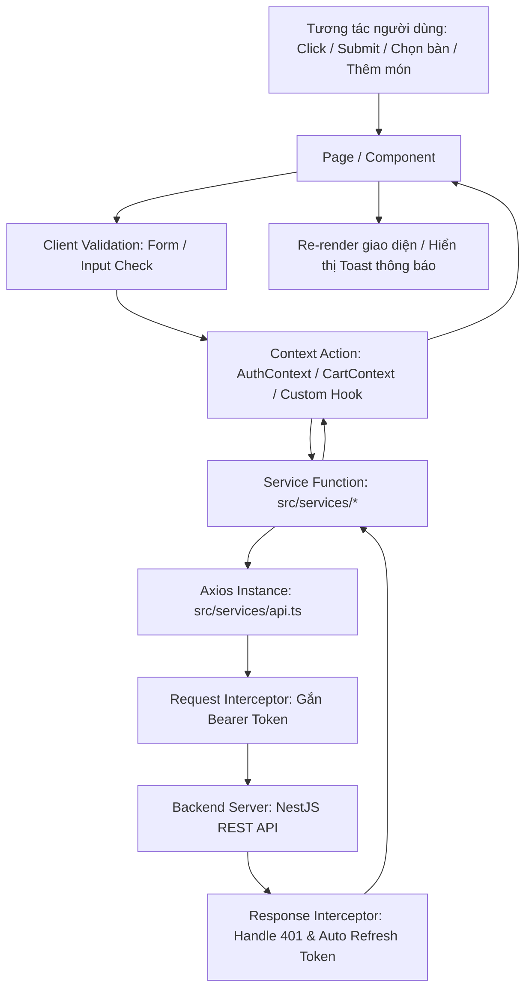

# Data Flow & Luồng dữ liệu (Web Frontend)

Tài liệu này mô tả chi tiết luồng di chuyển dữ liệu từ tương tác của người dùng trên giao diện Web đến Server Backend và ngược lại.

---

## 1. Sơ đồ luồng dữ liệu tổng quan

---

## 2. Chi tiết từng chặng của luồng dữ liệu

### Chặng 1: UI Component (`pages/` hoặc `components/`)
- Tiếp nhận tương tác: Chọn chi nhánh, ngày giờ đặt bàn, số người, chọn món ăn.
- Validate sơ bộ phía Client (số lượng > 0, email đúng format, trường bắt buộc).
- Kích hoạt Loading State (Spinner/Skeleton) và vô hiệu hóa nút submit để tránh duplicate request.

### Chặng 2: State & Context Layer (`features/*/` & `hooks/`)
- Cập nhật state toàn cục hoặc state cục bộ (ví dụ: cập nhật danh sách món trong `CartContext`, cập nhật thông tin user trong `AuthContext`).
- Điều phối gọi hàm API Service tương ứng.

### Chặng 3: Service Layer (`src/services/*`)
- Nhận tham số hoặc DTO từ UI.
- Gọi các phương thức HTTP thông qua `api.get()`, `api.post()`, `api.put()`, `api.delete()`.
- Trả kết quả dữ liệu đã được giải nén (`response.data.data` hoặc `response.data`).

### Chặng 4: Core Network Interceptors (`src/services/api.ts`)
- **Request Interceptor**: Tự động lấy Access Token từ LocalStorage hoặc Memory và đính kèm vào header: `Authorization: Bearer <token>`.
- **Response Interceptor**:
  - Khi thành công: Trả payload về cho Service.
  - Khi gặp lỗi HTTP 401 (Unauthorized): Tự động gọi endpoint Refresh Token để lấy token mới và retry request gốc. Nếu thất bại, chuyển hướng về `/login`.
  - Khi gặp lỗi HTTP 4xx/5xx: Bắt lỗi, hiển thị Toast cảnh báo và throw error về UI.

---

## 3. Quy tắc bắt buộc (Rules)

1. **KHÔNG BAO GIỜ** import `axios` tự do hay dùng `fetch()` trực tiếp trong React Component.
2. **KHÔNG BAO GIỜ** bỏ qua instance `src/services/api.ts`.
3. Mọi phản hồi dữ liệu phải được ép kiểu an toàn thông qua TypeScript interfaces tại `src/types/`.
4. Mọi thao tác async phải bọc trong `try...catch` và đảm bảo luôn tắt trạng thái Loading khi hoàn tất.
