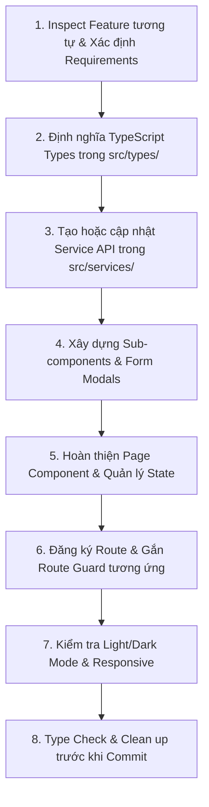

# Web Feature Development Workflow & Definition of Done

Bất kỳ AI Agent nào khi triển khai một tính năng mới hoặc chỉnh sửa tính năng hiện tại trên Web Frontend (`r-fe/`), đều phải tuân thủ quy trình dưới đây.

---

## 1. Quy trình phát triển Feature 8 Bước

### Bước 1: Inspect & Chuẩn bị
- Tìm kiếm các page / feature tương tự đã có sẵn trong `src/pages/` hoặc `src/components/` (ví dụ: `Branches.tsx`, `MenuItems.tsx`, `Tables.tsx`).
- Tái sử dụng các UI components dùng chung: `Modal.tsx`, `ConfirmModal.tsx`, `Pagination.tsx`.

### Bước 2: Định nghĩa Types
- Khai báo các TypeScript interfaces cho Request/Response payload tại `src/types/` (ví dụ: `reservation.type.ts`, `table.type.ts`).

### Bước 3: Tạo API Service
- Viết hàm gọi API trong `src/services/` thông qua axios client `api.ts`.

### Bước 4 & 5: Xây dựng UI & State
- Xây dựng component giao diện, áp dụng Tailwind CSS hỗ trợ cả Light Mode và Dark Mode.
- Đảm bảo xử lý đủ 4 trạng thái: **Loading, Error, Empty, Success**.
- Tuân thủ giới hạn: không file component nào vượt quá **1000 dòng**.

### Bước 6: Cấu hình Routing
- Đăng ký Route trong `src/App.jsx`.
- Bọc Guard tương ứng: `ProtectedRoute`, `AdminRoute`, hoặc `StaffRoute`.

### Bước 7 & 8: Kiểm thử & Clean up
- Chạy kiểm tra build: `npm run build` hoặc `npx tsc --noEmit`.
- Dọn dẹp toàn bộ `console.log` thừa và file rác trước khi commit.

---

## 2. Definition of Done (DoD) Checklist

Trước khi coi một feature là hoàn thành, Agent **PHẢI** kiểm tra các tiêu chí sau:

- [ ] Đã inspect code/feature tương tự trước khi tạo implementation mới.
- [ ] Không gọi `axios` trực tiếp trong component; luôn qua `src/services/api.ts`.
- [ ] Không hardcode URL API; sử dụng `VITE_API_BASE_URL`.
- [ ] Không vượt quá **1000 dòng code** trên một file component.
- [ ] Giao diện hỗ trợ đầy đủ cả **Light Mode** và **Dark Mode**.
- [ ] Xử lý đầy đủ 4 UI States: Loading, Error, Empty, Success.
- [ ] Tuyệt đối không dùng `window.confirm()` hay `alert()`; sử dụng `ConfirmModal.tsx` và `Modal.tsx`.
- [ ] Đã bọc Route Guards (`AdminRoute`, `StaffRoute`, `ProtectedRoute`) nếu là route nhạy cảm.
- [ ] Đảm bảo không có lỗi biên dịch TypeScript (`npm run build`).
